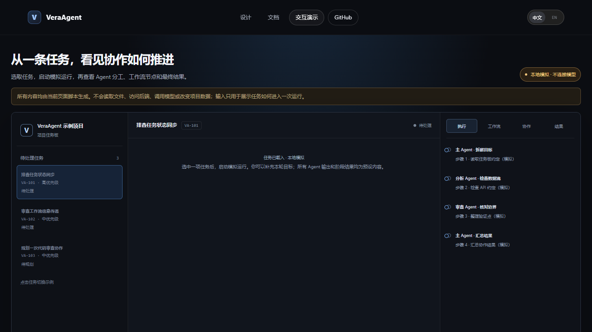

# VeraAgent

VeraAgent 是一个面向本地软件项目的桌面 AI Agent 工作站：把项目任务看板、主 Agent 对话、多 Agent 协作、可编排的工作流/组织架构，以及文件和开发工具放在同一个本地应用中。Agent 执行基于 mini-swe-agent 的轻量代码 Agent 基座，交互与扩展设计借鉴 Pi Agent 的简洁思路；这描述的是项目方向，不代表上游项目为 VeraAgent 背书。

目前桌面壳采用 **pywebview + WebView2**，界面由 React、TypeScript 和 Vite 构建，后端是 Python/Starlette。项目仍处于积极开发阶段；本仓库如实记录当前行为和已知限制，不把计划中的能力描述成已交付能力。

## 先看演示

[](website/assets/video/veraagent-task-collaboration-demo.webm)

这是一个基于脚本数据的交互演示，不连接 VeraAgent 后端、模型服务或访客本地文件。可以[查看演示页面源码](website/playground/index.html)或[打开演示录像](website/assets/video/veraagent-task-collaboration-demo.webm)。

## 当前能做什么

- 绑定本地项目目录并在项目上下文中进行 Agent 对话。
- 配置模型提供方和模型参数；模型服务凭证由使用者自行配置。
- 按权限设置处理文件操作和工具调用，并在界面中查看工具执行事件。
- 管理项目规则、对话记忆、MCP 服务、Skill 和工作流/架构实例。
- 在右侧工作区使用项目任务看板，跟踪待办、执行中和已完成事项，并将工作项关联到项目内 Agent 对话。
- 在界面提供的项目、文件、终端、Git 等工具中协作；实际可用范围以当前设置、项目状态和工具实现为准。

这不是操作系统级沙箱。项目目录范围设置用于约束应用层的文件操作；本地终端命令仍以当前 Windows 用户身份运行。请只绑定可信项目，并在启用外部 MCP/Skill 前审查其代码和权限。

## Windows 桌面版

当前以源码方式运行 Windows 桌面版。安装 Git、Node.js/npm、Python 3.10+、uv 0.11.15 和 Microsoft Edge WebView2 Runtime 后，在 PowerShell 中执行：

```powershell
git clone https://github.com/Felix-0625/Agents.git
cd Agents/frontend
npm ci
cd ..\vera-agent
uv sync --locked --no-dev --extra desktop
cd ..
.\start-desktop.ps1
```

这会从源码安装锁定依赖并启动桌面应用；需要访问 GitHub、npm 和 Python 包索引。模型 API Key 由用户在应用设置中填写。详见 [Windows 源码安装](docs/INSTALL_WINDOWS.md)。

开发者也可以走本地源码启动流程，见 [开发指南](docs/DEVELOPMENT.md)。

## 项目结构

```text
frontend/              React + TypeScript 桌面界面
vera-agent/            Python Agent、工具、会话和本地 API
vera-agent/tests/      后端单元、集成和 API 测试
examples/              项目配置示例与只读 MCP 服务示例
tests/                 仓库级验证入口与测试说明
docs/                  面向使用者和维护者的事实型文档
website/               静态产品介绍页与 GitHub Pages 部署配置
```

## 验证

```powershell
./tests/check-all.ps1
```

脚本执行后端 pytest、MCP 示例握手、静态网站链接检查、前端 lint 和 TypeScript/Vite 生产构建。测试覆盖、跳过项和外部服务边界记录在[测试指南](docs/TESTING.md)。脚本不安装依赖，也不调用在线模型服务。

## 环境变量

桌面端的模型提供方、API 地址和凭据优先在应用的“设置 → 模型”中配置；下面的变量主要供 Python Agent 兼容配置、可选服务和开发/自动化场景使用。`.env.example` 只列出这些环境变量，不包含真实密钥。Python 后端默认从 VeraAgent 用户配置目录的 `.env` 读取；可用 `VERA_GLOBAL_CONFIG_DIR` 指定包含 `.env` 的目录。

| 变量 | 用途 | 默认值 | 必需 |
| --- | --- | --- | --- |
| `VERA_GLOBAL_CONFIG_DIR` | Python 全局配置目录；目录中读取 `.env` | Windows `%LOCALAPPDATA%\vera-agent\vera-agent`（platformdirs） | 否 |
| `MSWEA_MODEL_NAME` | 遗留 Python CLI/适配器的默认模型名 | 未设置 | 仅直接使用该适配器且未传模型时 |
| `OPENROUTER_API_KEY` | OpenRouter 模型服务密钥 | 未设置 | 仅选择 OpenRouter 时 |
| `PORTKEY_API_KEY` | Portkey 网关密钥 | 未设置 | 仅选择 Portkey 时 |
| `PORTKEY_VIRTUAL_KEY` | Portkey 虚拟密钥；按所用 Portkey 模型配置 | 未设置 | 否 |
| `REQUESTY_API_KEY` | Requesty 模型服务密钥 | 未设置 | 仅选择 Requesty 时 |
| `TAVILY_API_KEY` | 可选 Tavily 网页搜索；未配置时搜索工具尝试 DuckDuckGo | 未设置 | 否 |
| `LITELLM_MODEL_REGISTRY_PATH` | LiteLLM 自定义模型元数据注册表路径 | 未设置 | 否 |
| `MSWEA_COST_TRACKING` | 成本元数据缺失或报错时的处理方式：`default` 或 `ignore_errors` | `default` | 否 |
| `MSWEA_GLOBAL_COST_LIMIT` | 进程级模型累计费用上限；`0` 表示禁用 | `0` | 否 |
| `MSWEA_GLOBAL_CALL_LIMIT` | 进程级模型调用次数上限；`0` 表示禁用 | `0` | 否 |
| `MSWEA_MODEL_RETRY_STOP_AFTER_ATTEMPT` | 模型请求最多尝试次数 | `10` | 否 |
| `VERA_AGENT_BASH_PATH` | Windows 本地命令工具所用 Git Bash 的 `bash.exe` 路径覆盖项 | 自动查找 Git 安装目录 | 否 |

其他服务商的密钥（例如 `ANTHROPIC_API_KEY`、`OPENAI_API_KEY`、`DEEPSEEK_API_KEY`）由 LiteLLM 等模型适配器按所选模型读取；桌面端配置保存在应用设置中，通常不需要手工设置这些变量。变量的读取位置和覆盖方式见 [配置与本地数据](docs/CONFIGURATION.md)，完整示例见 [`.env.example`](.env.example)。不要把 API 密钥放入 README、提交记录或公开日志。

## 文档与演示

- [架构概览](docs/ARCHITECTURE.md)
- [工具、权限与 MCP](docs/TOOLS_AND_MCP.md)
- [配置与本地数据](docs/CONFIGURATION.md)
- [可运行示例说明](examples/README.md)
- [测试与已知限制](docs/TESTING.md)
- [Windows 源码安装](docs/INSTALL_WINDOWS.md)
- [贡献指南](CONTRIBUTING.md)
- [网站现状](website/README.md)

网站分为独立的设计首页、文档页和 mock 交互演示页。GitHub Pages 工作流会在部署前检查页面和本地链接，但仍需在 GitHub 仓库中手动触发；当前工作区没有部署到公共站点。

## 许可证与上游

VeraAgent 原创代码采用 MIT 许可证。`vera-agent/` 中包含来自 mini-swe-agent 的代码，其原作者署名和 MIT 许可文本继续保留。Python 桌面运行依赖和前端锁文件依赖已记录在[第三方许可证清单](docs/THIRD_PARTY_LICENSES.md)；logo 由维护者确认是 AI 生成，生成服务及其条款尚未记录，发布前仍需维护者核对。参见 [LICENSE](LICENSE)、[NOTICE](NOTICE.md) 和 [许可证说明](docs/LICENSES.md)。
