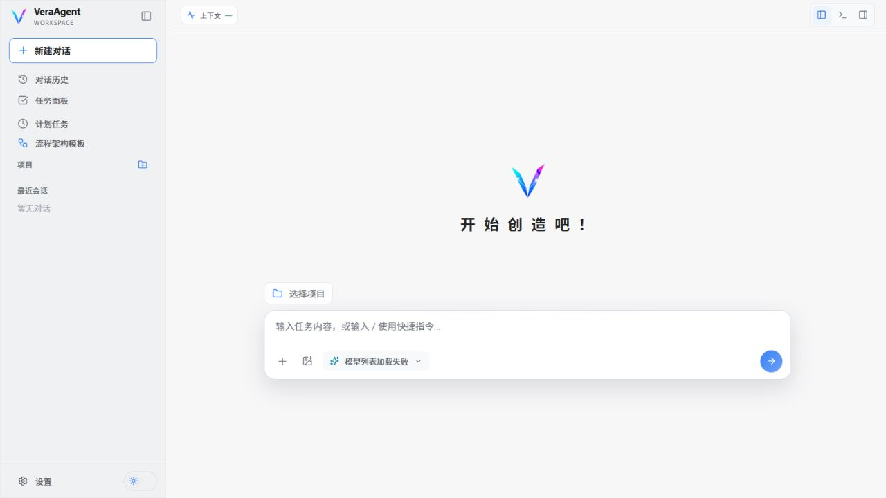

# VeraAgent

[English](README.md) | **简体中文**

[项目官网](https://felix-0625.github.io/Vera-Agent/) · [下载 v0.1.0-alpha.1](https://github.com/Felix-0625/Vera-Agent/releases/tag/v0.1.0-alpha.1) · [安装说明](docs/INSTALL_WINDOWS.md) · [发行说明](CHANGELOG.md)

VeraAgent 是面向软件项目的本地单用户 AI Agent 工作站：把项目任务看板、主 Agent 对话、子智能体、多 Agent 协作，以及**可自定义的工作流与组织架构**放在同一个桌面应用中。模板只需设计一次，就可以在项目中实例化，并从对话里直接调用。

Agent 内核基于 [mini-swe-agent](https://github.com/SWE-agent/mini-swe-agent)，工具设计沿用 Pi Agent 的极简思路（read、write、edit、bash 四个原语）。这里说明的是技术渊源，不代表上游项目为 VeraAgent 背书。

[项目官网](https://felix-0625.github.io/Vera-Agent/)展示桌面界面、系统设计和使用文档。首页的界面示意是静态样例。



[本版真实模型运行记录与验证范围](docs/RELEASE_0_1_0_ALPHA_1.md)

## 功能

- **项目**：绑定本地目录，在项目上下文中与 Agent 对话（可在设置中启用读取项目的 `AGENTS.md` 规则）。
- **任务看板**：跟踪项目工作项（待规划 → 已完成），并关联到对话。
- **子智能体**：主 Agent 可以把调研和评审委派给隔离的子智能体。
- **工作流与组织架构**：在可视化编辑器中搭建模板（对话窗口、是/否判断、循环），按项目填写目标和背景后实例化，在对话中确认后运行。每个节点使用独立会话，经 Supervisor 复核后结果回到发起对话。
- **工具**：文件浏览、Diff/暂存/检查点、Git 分支、终端、MCP 服务、Skill、定时任务和用量统计。
- **评测与学习**：每轮对话在本地记录执行轨迹并打分；按用户、项目、会话分层的版本化长期记忆，按预算召回；基于真实对话管线的评测执行器（`vera-eval`）；改进提案必须通过评测门禁并经你批准后才生效（[详情](docs/LEARNING_LOOP.md)，英文）。
- **权限**：按类别审批（编辑、终端、搜索、MCP、委派），每次工具调用都会显示在对话中。

VeraAgent **不是**操作系统级沙箱：终端命令以当前 Windows 用户身份运行。请只绑定可信项目，启用 MCP 服务和 Skill 前先审查其代码。

## 快速开始（Windows）

需要 Windows 10/11、Git、Python 3.10+、[uv](https://docs.astral.sh/uv/) 0.11+ 和 Microsoft Edge WebView2 Runtime。Node.js 推荐使用 24 LTS，也支持 20.19+ 或 22.12+。

```powershell
git clone --branch v0.1.0-alpha.1 --depth 1 https://github.com/Felix-0625/Vera-Agent.git
cd Vera-Agent\frontend
npm ci
cd ..\vera-agent
uv sync --locked --no-dev --extra desktop
cd ..
.\start-desktop.ps1
```

启动后在 **设置 → 模型** 中添加模型。VeraAgent 只在 GitHub 以源码形式发布，不提供 npm 包、PyPI 包或签名安装程序。详见 [Windows 安装说明](docs/INSTALL_WINDOWS.md)（英文）。

## 可运行示例

从[示例目录](examples/README.md)选择入口。每个示例都说明准备条件、执行命令、预期结果、生成文件、重复运行方式和清理步骤。

| 体验目标 | 示例 | 是否调用模型 |
| --- | --- | --- |
| 模板 → 项目实例 → 确认运行 → 结果回到原对话 | [工作流快速开始](examples/workflow-quickstart/README.md) | 准备和 dry run 不调用；桌面端运行会产生模型费用 |
| 中文记忆召回、项目隔离、变更确认、版本恢复，以及真实评测验收命令 | [记忆与评测](examples/learning-loop/README.md) | 自动检查使用脚本化模型；可选运行单条真实模型评测 |
| 使用真实 MCP stdio 连接两个可检查的只读工具 | [MCP 示例服务](examples/mcp-server/README.md) | 不调用 |

先安装[开发依赖](docs/DEVELOPMENT.md)，再从仓库根目录执行：

```powershell
.\vera-agent\.venv\Scripts\python.exe examples\workflow-quickstart\setup_demo.py --dry-run
.\vera-agent\.venv\Scripts\python.exe examples\learning-loop\verify.py
.\vera-agent\.venv\Scripts\python.exe examples\mcp-server\test_client.py
```

这些命令使用合成输入，验证真实本地接口、工具、存储或 MCP 通信，不产生付费模型请求。评测示例会明确标注脚本化模型；通过示例不代表真实模型能力或 RSI 改进效果已验证。真实模型步骤单独列出，不进入 CI。

## 文档

维护文档以英文为准，入口见 [README.md](README.md#documentation)：架构与模块地图、HTTP API、数据模型、配置与环境变量、工具与权限、测试与验收记录、贡献指南。

更新后的[双语设计图与可编辑源文件](website/diagrams/README.md)覆盖运行架构、对话时序、编排生命周期、本地数据和学习闭环。

[学习接口契约](docs/LEARNING_API.md)列明记忆、执行记录反馈、提案门禁与采纳/回滚的请求字段、响应、错误和默认行为。

## 验证

```powershell
./tests/check-all.ps1
```

依次运行代码规范检查、后端测试、仓库级测试（示例、文档、仓库卫生）、MCP 示例、网站检查，以及前端 lint、单元测试和生产构建。脚本不安装依赖，也不调用模型 API。

Python 使用 Ruff，前端使用严格 TypeScript、Oxlint 和 Prettier，CI 检查格式与代码体积。自有代码文件（含测试、CSS 和网站脚本）不得超过 1000 行；运行时模块目标为 450 行，已有例外只允许收缩。依赖锁文件和第三方 vendor 文件单独管理。

## 当前状态

项目处于 Alpha 阶段，主要面向 Windows 本地单用户使用。回归测试和示例验证用于检查行为一致性，不等同于长期压力测试或真实模型效果评测。当前行为、限制和历史验证范围见 [docs/TESTING.md](docs/TESTING.md)。

## 许可证

MIT，见 [LICENSE](LICENSE)。`vera-agent/` 包含源自 mini-swe-agent 的代码，其 MIT 声明保留在 [vera-agent/LICENSE.md](vera-agent/LICENSE.md)。另见 [NOTICE.md](NOTICE.md) 和[第三方许可证清单](docs/THIRD_PARTY_LICENSES.md)。
