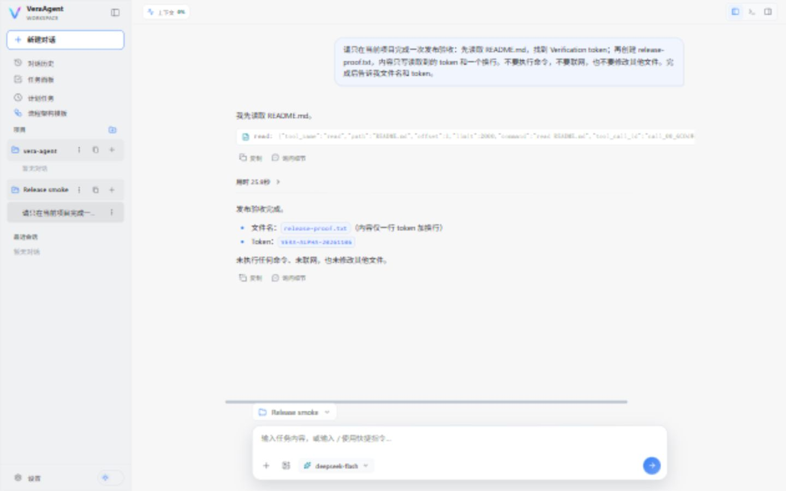

# v0.1.0-alpha.1 verification

Date: 2026-11-06. This is a Windows source prerelease, not a signed binary or a hosted Agent service.

## Automated checks

- Backend: 945 passed, 81 skipped, one existing Pydantic warning (Python 3.14.5).
- Repository: 48 passed (documentation, API index, examples, source size and hygiene).
- MCP: real stdio handshake, discovery and four read-only fixture calls passed.
- Website: three entry pages and local links/assets validated.
- Frontend: 46 tests passed; Oxlint, Prettier and production build passed.

The first full gate stopped at Prettier for the new website translation key. The
key was formatted, then frontend formatting, tests and build were rerun successfully.
Hosted CI must also pass for the exact release commit; see its Actions run and the
verification attachment on the GitHub Release for publication results.

## Isolated Windows installation and real model smoke

A separate source directory was populated from tracked repository files plus the
release changes. It contained no developer virtual environment, node_modules or
application configuration. This was a fresh directory on the maintainer's existing
Windows 11 machine, not a newly provisioned Windows VM.

- Node.js 24.20.0: `npm ci` passed against the checked-in lockfile.
- uv 0.11.15 / Python 3.12.13: `uv sync --locked --no-dev --extra desktop --python 3.12`
  installed 100 packages, including VeraAgent `0.1.0a1`.
- `start-desktop.ps1` built the frontend and opened the actual WebView2 desktop window.
- The native folder picker selected an isolated Git fixture and the UI created its project.
- After first launch, an existing model profile was configured locally for the smoke only.
  No credentials or application data are included in the source archive.
- The actual UI used DeepSeek `deepseek-flash`, thinking disabled, output capped at
  1024 tokens per response and at most three tool calls.
- One user task read `README.md`, requested approval for `write`, and created
  `release-proof.txt`. The file bytes decoded to exactly `VERA-ALPHA-20261106\n`.
- The UI displayed the completed task, filename and token. Reloading and opening the
  saved conversation restored its result.
- The desktop window was closed normally and relaunched from the isolated environment.
  The project and saved conversation were still present, and opening the conversation
  restored the same filename and token. Its screenshot below was taken after restart
  at the desktop application's 1440-by-900 viewport.

## Boundaries

This small real-provider smoke proves the tested read/approval/write/result path,
not multi-agent quality, every provider, workload stability or self-improvement gains.
MCP was checked through the stdio example; this pass did not accept every third-party
MCP integration or Skill UI. Docker/ConTree optional tests remain skipped as reported.
No performance claims, paid benchmark, load test or long-running evaluation are made.

The release attachment records the final commit, CI, public Pages deployment and
download checksum results. Source installation still needs the documented external
dependencies and a user-provided model account.
