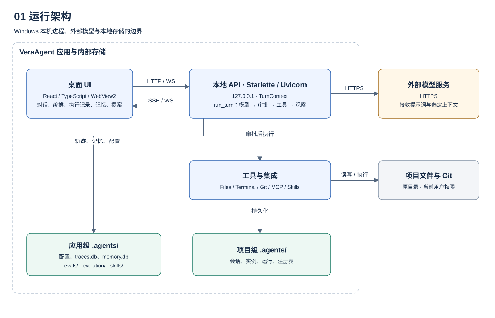
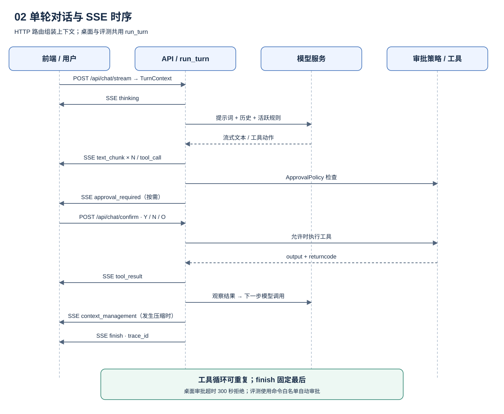
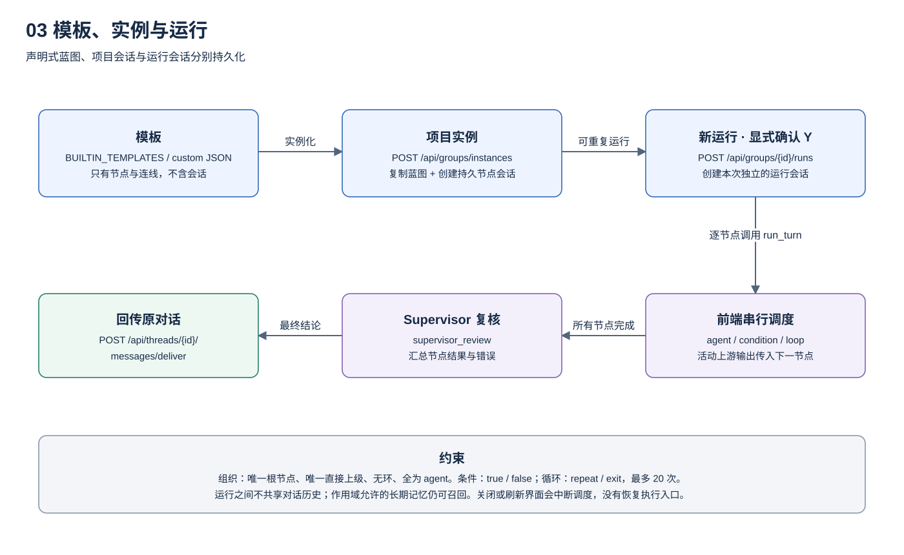
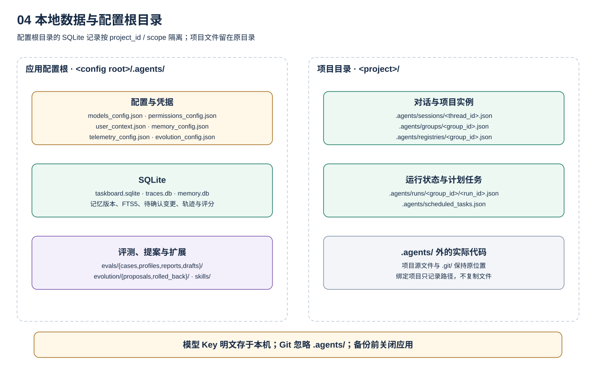
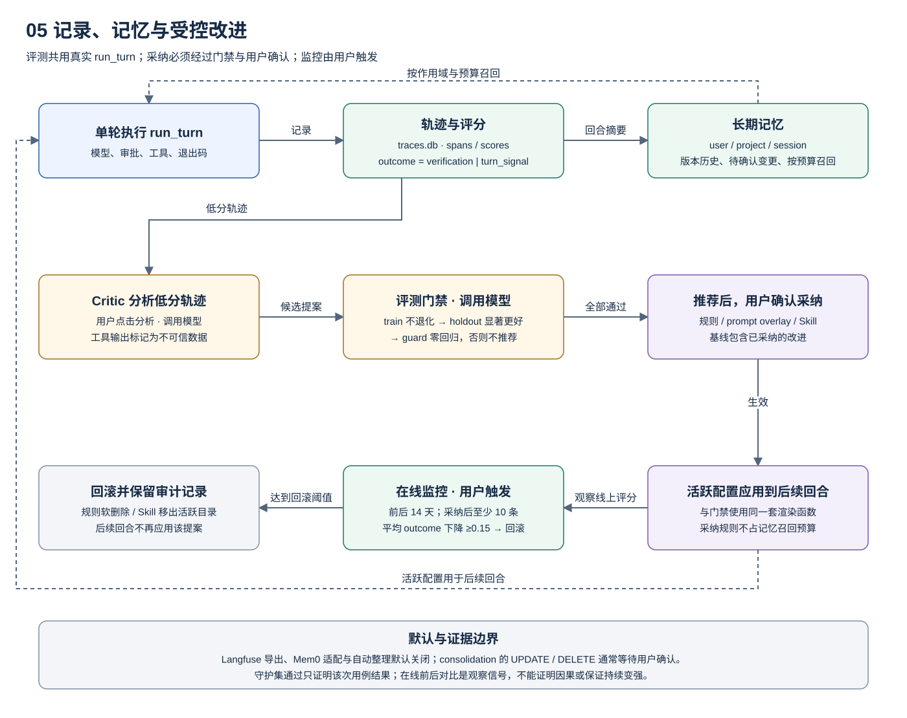

# 系统设计文档

本页说明 VeraAgent **当前代码的设计方式**：要解决的问题、整体架构、关键设计决策、运行时行为和已知边界。内容以仓库源码和测试为准，不描述规划中但未实现的能力。安装、配置和日常操作步骤见[使用文档](../docs/index.md)。

左侧目录：概述与目标 · 整体架构 · 关键设计决策 · 对话与工具调用链 · 组织架构与工作流 · 本地数据模型 · 质量属性与边界 · 已知限制。

## 概述与目标

VeraAgent 是运行在本机的 AI Agent 工作台，面向已有代码仓库的软件项目。它把项目绑定、模型对话、任务看板、组织架构和工作流编排放进同一个 Windows 桌面应用。项目文件留在原目录，无需整体上传到 VeraAgent 托管服务；模型请求仍会把提示词和选定的项目上下文发送给用户配置的提供商。

**目标：**

- 面向单机单用户；配置、会话和运行记录保存在本机，不经过 VeraAgent 托管服务。
- 支持"一个主 Agent 对话"和"多角色协作（组织架构/工作流）"两种协作形态,共用同一套对话执行引擎。
- 让协作关系（谁向谁汇报、步骤如何连接）变成可编辑、可复用的模板,而不是写在提示词里的隐性约定。

**非目标（当前明确不做的事）：**

- 不是托管式多租户服务,本地 API 没有调用者身份认证,只能绑定 loopback 使用。
- 不提供操作系统级沙箱,终端命令、文件和 Git 操作都以当前 Windows 用户权限执行。
- 不保证模型内部推理过程可审计,可观测、可持久化的是对话记录、工具调用与工具结果,不是模型的隐藏思维链。
- 工作流/组织运行不支持并行调度和中断后恢复（见「已知限制」）。

## 整体架构



```text
React + TypeScript UI（Vite 构建）
          │ HTTP / SSE / WebSocket（仅 loopback）
          ▼
Python Starlette API（Uvicorn, 127.0.0.1:8000 起）
          ├─ ServerState：当前项目、会话、注册表、权限、内存态
          ├─ Agent / 模型循环：对话历史、模型请求、工具动作、观察结果
          └─ 本地工具：文件、终端命令、Git、MCP、Skill 适配器
          │
          ▼
本地数据：应用级 / 项目级 .agents（JSON + SQLite）、项目文件与 Git 状态
```

`start-desktop.ps1` 构建前端产物，再运行 `vera_agent.desktop`：它在 8000 起始的空闲端口启动本地 API，由同一个服务托管前端产物，并用 pywebview/WebView2 打开桌面窗口。开发模式下 Vite 把 `/api` 代理到本地后端。API 没有做成托管服务，只是把三层（界面、业务逻辑、数据）跑在同一台机器上。

| 层 | 主要代码 | 职责 |
| --- | --- | --- |
| 界面 | `frontend/src/` | 项目、对话、任务看板、组织架构/工作流编辑器、运行状态展示 |
| 本地 API | `vera-agent/src/vera_agent/server/` | 路由、输入校验、会话与项目状态、权限策略、持久化 |
| Agent 与模型 | `agents/`、`models/`、`server/chat/` | 模型请求、工具动作解析与执行、审批、子智能体中继、MCP 连接管理 |
| 工具 | `tools/`、`environments/` | 文件、终端命令、Git、MCP、Skill 等能力的具体实现 |
| 数据 | 应用级/项目级 `.agents/`、项目文件与 Git | 配置、会话、实例、运行记录、任务看板、实际代码 |

## 关键设计决策

这一节记录几个不是"唯一做法"、因此需要说明取舍的设计选择。

**1. 工作流调度放在前端，后端只做状态机校验。**
`workflowRunner.ts` 是真正的调度器：按拓扑顺序逐节点调用 `/api/chat/stream`，决定下一步走哪条边。后端的 `PATCH /api/groups/{group_id}/runs/{run_id}` 只校验"这次状态变化是否被状态机允许"并原子落盘，不参与调度决策。取舍是：实现简单、便于在 UI 里展示执行过程，代价是调度状态只存在于渲染进程——关闭或刷新界面会打断正在进行的运行（持久化的节点状态不丢，但没有恢复执行的入口）。

**2. 组织架构强制是一棵树，工作流不作此限制。**
架构模式（`group_mode: "architecture"`）要求只能是单一顶层、每个节点唯一上级、无环、且全部是 `agent` 节点；工作流模式（`workflow`）允许更自由的图结构，循环通过专门的 `loop` 节点表达。这条校验（`organization_tree_error`）在创建实例、更新实例、保存自定义组织模板三个入口统一生效，理由是"汇报关系"本身就该是树形的，在数据层面强制比在编辑器里靠约定更可靠。

**3. 节点类型分三层，范围故意不同。**
`compose_group` 接口在协议层面接受 19 种节点类型（`agent/start/input/condition/code/tool/http/...`），但常规编辑器（`WorkflowTab.tsx`）只暴露 `agent/condition/loop` 三种可添加的类型，运行时调度器（`workflowRunner.ts`）也只为这三种类型实现了执行逻辑。其余类型目前能以数据形式存储，但没有对应的运行时执行器：协议先占住扩展位，执行逻辑做实一种才在编辑器和运行时同步放开一种，不会让界面显示一个实际跑不动的节点类型。

**4. 模板、实例、运行是三个独立对象，而不是同一份数据的三种视图。**
模板是纯声明式蓝图，不含任何会话；实例化时才把模板节点/边复制进项目，并为每个节点创建一个持久化的 `ThreadSession`；每次运行再额外创建一批隔离的会话，不与实例本身的会话或历史运行共享对话上下文。这样同一个实例可以反复发起互不干扰的运行，各次运行不共享对话历史，但符合作用域的长期记忆仍可被召回。

## 对话与工具调用链



一轮对话由前端发起 `POST /api/chat/stream`（SSE）。服务端读取选中的会话、项目与模型配置，调用模型；模型如果返回工具动作，按权限策略决定是否需要用户确认，再执行工具并把结果作为 observation 喂回模型，循环直至模型不再请求动作或触达步数/工具调用上限。

真实的事件序列（按触发顺序，可重复多轮）：

```text
thinking            步骤状态提示（非模型推理内容）
text_chunk ×N       模型流式文本片段（有文本输出时）
──若模型请求工具，对每个动作依次──
  tool_call               模型请求执行某个工具
  [approval_required]     仅当权限策略要求用户确认时出现
  tool_result              工具执行完成，output 截断到 5000 字符
──结果回填模型，可能进入下一轮──
[context_management]   仅当发生对话压缩时出现
finish              本轮结束，固定作为最后一个事件
```

`approval_required` 不在同一条 SSE 流里等待回复：前端另开一个 `POST /api/chat/confirm`（携带 `thread_id`、`action_id`、`choice`）把用户选择写回服务端等待中的请求，默认 300 秒无响应会按拒绝处理。另外三个控制端点 `/api/chat/interrupt`、`/pause`、`/resume` 作用于**单轮对话内的流式输出**（打断、暂停、恢复），和工作流运行层面的"恢复执行"是完全不同的两件事，不要混用这两个概念。

## 组织架构与工作流



**三层模型：**

1. **模板**：内置模板（`session/templates.py` 中的 `BUILTIN_TEMPLATES`，共 4 个：`supervisor_dev` 架构模板，`sequential_workflow`、`adversarial_audit`、`swarm_mesh` 工作流模板）或用户保存的自定义 JSON，只是角色/步骤和连接关系的声明，不含会话。
2. **实例**：`POST /api/groups/instances` 把模板节点/边复制进具体项目，填入项目的 `goal`/`background`，并为每个 `agent` 节点创建一个持久化、可独立对话的会话（`thread_ids`）。一个实例可以反复发起运行。
3. **运行**：用户显式传入 `confirmation: "Y"` 后，`POST /api/groups/{group_id}/runs` 为这次运行创建另一批隔离会话（不与实例会话共享历史）。前端调度器从起点 `agent` 节点开始，按拓扑顺序逐节点调用对话接口，把上游活跃分支的输出作为下游输入，遇到 `condition`/`loop` 节点时把该节点会话的可用工具限制为内部的 `__orchestration_control__`，要求模型只能回答严格的 `YES`/`NO`（`loop` 节点还有 1–20 次的迭代上限）。所有节点完成后，由一次 `supervisor_review` 复核整体结果，再通过 `POST /api/threads/{thread_id}/messages/deliver` 把结论写回发起这次运行的原始对话。

**组织架构的强制约束（三处入口统一校验）：**

- 只能有一个没有上级的根节点。
- 每个节点最多一个直接上级（即每条边的 `target` 只能出现一次）。
- 不允许自环，也不允许从任意节点向上追溯出现重复（即不允许环）。
- 节点必须全部是 `agent` 类型，不能混入 `condition`/`loop` 等控制节点。

**工作流节点类型的三层范围：**

| 层级 | 支持的类型 | 说明 |
| --- | --- | --- |
| 协议（`compose_group`） | `agent, start, input, condition, code, tool, http, knowledge, document, variable, aggregator, template, parallel, loop, iteration, approval, error, output, end` | 数据结构层面可以存储，供外部调用方或未来扩展使用 |
| 编辑器（`WorkflowTab.tsx`） | `agent, condition, loop` | 常规工作流编辑器界面只能添加这三种节点 |
| 运行时执行器（`workflowRunner.ts`） | `agent, condition, loop` | 调度器只为这三种类型实现了执行逻辑，其余类型会在运行时报错"没有执行器" |

`condition` 节点有 `true`/`false` 两个出口，`loop` 节点有 `repeat`/`exit` 两个出口，两者都必须各自连线，否则运行时会报错。

## 本地数据模型



数据分两级根目录，均命名为 `.agents/` 且被 Git 忽略：

```text
<应用根>/.agents/                      ← 桌面启动时是 <checkout>/vera-agent/.agents/
├── projects_history.json             绑定过的项目列表
├── models_config.json                模型配置，含明文 API Key
├── permissions_config.json           权限策略
├── mcp_servers.json / skills/        MCP 服务与 Skill
├── templates/topology/<id>.json      自定义拓扑模板
├── taskboard.sqlite                  任务看板（WAL 模式）
├── user_context.json / user_memories.json  # 后者仅用于一次性迁移
├── traces.db / memory.db                # 轨迹评分、作用域记忆、历史与待确认变更
├── telemetry_config.json / memory_config.json / evolution_config.json
├── evals/{cases,profiles,reports,drafts}/
└── evolution/{proposals,rolled_back}/

<项目目录>/.agents/
├── sessions/<thread_id>.json         每个对话一个文件
├── groups/<group_id>.json            组织架构/工作流实例
├── runs/<group_id>/<run_id>.json     每次运行的记录
├── registries/<group_id>.json        实例的显式 Agent 注册表
└── scheduled_tasks.json              一次性定时任务
```

绑定一个项目只是记录其本地路径，不会复制或隔离项目文件；项目文件和 Git 状态仍留在原目录。模型 API Key 以**明文**存在 `models_config.json`，API 响应不会返回它，但本地文件本身没有加密，这是需要在使用文档里明确提醒用户备份和权限管理的点。

### 执行记录、长期记忆与改进提案



每轮桌面对话由 `run_turn` 记录 trace、模型/工具 span 与独立分数。`verification` 只取最后一次被识别为测试、构建或检查的命令退出码；普通命令和纯版本/帮助查询不覆盖验证结果。`outcome` 优先采用 `verification`，没有验证命令时采用 `turn_signal`，点赞与下一条消息的弱反馈单独存放。

长期记忆保存在配置根的 `memory.db`，按用户、项目和会话作用域过滤，保留版本、软删除和待确认变更。FTS5 trigram 配合短词匹配支持中文检索。模型不能直接写入 `rule`；采纳后的规则由活跃配置应用，使用与评测门禁相同的渲染函数，不占普通记忆召回预算。

用户触发 Critic 分析低分轨迹后，可启动训练集→留出集→守护集评测。评测在独立 Git 仓库和配置目录里调用同一个 `run_turn`；基线包含已经采纳的改进。训练不得退化、留出必须显著更好、守护不得回归，全部通过才推荐，之后仍需用户确认采纳。点击在线监控可比较采纳前后 14 天的评分；采纳后至少 10 条轨迹且均分下降至少 0.15 时回滚。监控没有后台定时器。

Critic 和评测会调用配置的真实模型并产生费用。Langfuse 导出、Mem0 适配器和记忆自动整理默认关闭；本地保存不表示模型请求不出机器，提示词和选定上下文仍发送给配置的提供商。完整规则见[学习闭环](../../../docs/LEARNING_LOOP.md)。

## 质量属性与边界

**性能与一致性取舍：** 工作流/组织运行是严格串行的——调度器对每个节点都是 `await` 之后才进入下一个，即便图结构上存在可并行的分支，也不会并发执行。这牺牲了吞吐量，换来的是结果顺序确定、后端状态机校验简单（不需要处理并发写同一个运行记录的竞态）。任务看板的并发写入通过 `version` 字段做乐观锁（`PATCH` 必须带上当前版本号，否则 409），这是数据库记录层面另一种更细粒度的一致性策略。

**安全边界：**

- 本地 API 没有调用者身份认证，只应绑定在 loopback 使用；HTTP 请求和终端 WebSocket 均会检查 `Host` 与 `Origin`，拒绝非 loopback 来源。
- 模型服务商是用户自行配置的外部服务，提示词和选定的项目上下文会被发送给它。
- 文件、终端、Git、MCP、Skill 等工具按当前 Windows 用户权限执行，不是操作系统沙箱；"项目范围"只是应用层的路径策略。
- 外部 MCP/Skill 包的市场条目不是安全认证，启用前需要自行检查源码、执行的命令、环境变量和网络访问。

**可靠性：** 对话记录、实例、运行记录都落盘为 JSON/SQLite，不会因为进程重启丢失状态；但调度器状态只活在渲染进程里，所以"数据没丢"和"运行能继续"是两件分开的事——后者目前没有对应的恢复入口。

## 已知限制

- 工作流/组织运行没有并行调度，也没有运行中断后的恢复端点（`PATCH` 只能记录已发生的状态变化，不能重新驱动调度）。
- 工作流编辑器和运行时目前只支持 `agent`、`condition`、`loop` 三种节点；协议层声明的其余类型暂不可执行。
- 本地 API 无身份认证，不适合暴露到 loopback 之外。
- 模型凭据以明文存储在本地文件，没有操作系统级加密或密钥库集成。
- 终端、文件、Git 操作没有独立于 Windows 账户权限之外的沙箱隔离。

完整模块地图与逐路由细节见[仓库架构文档](../../../docs/ARCHITECTURE.md)和[数据模型文档](../../../docs/DATA_MODEL.md)；接口契约以[使用文档的接口参考](../docs/api.md)和自动生成的[API 索引](../../../docs/API.md)为准。

全部图稿提供 [SVG 图库](https://github.com/Felix-0625/Vera-Agent/blob/main/website/diagrams/README.md)和 [draw.io 可编辑源文件](https://github.com/Felix-0625/Vera-Agent/blob/main/website/diagrams/system-design.drawio)。
