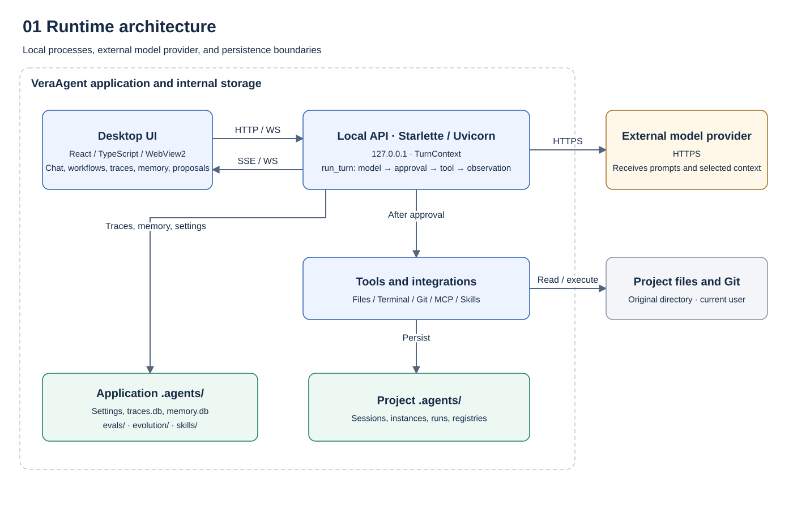
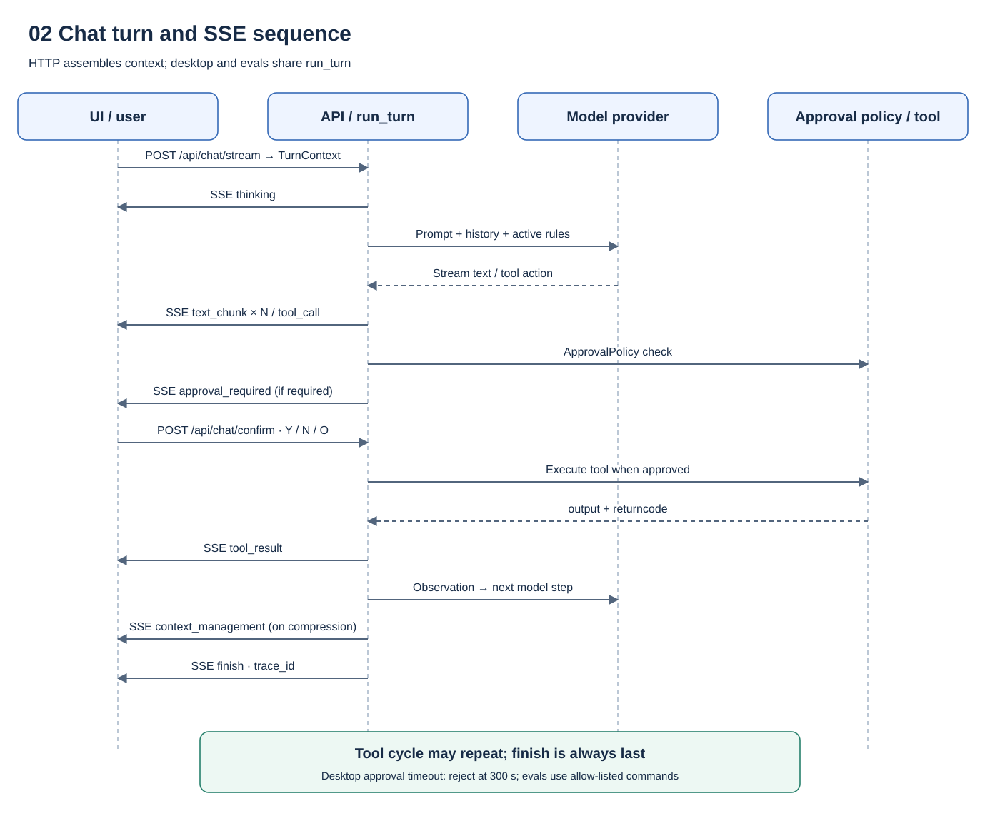
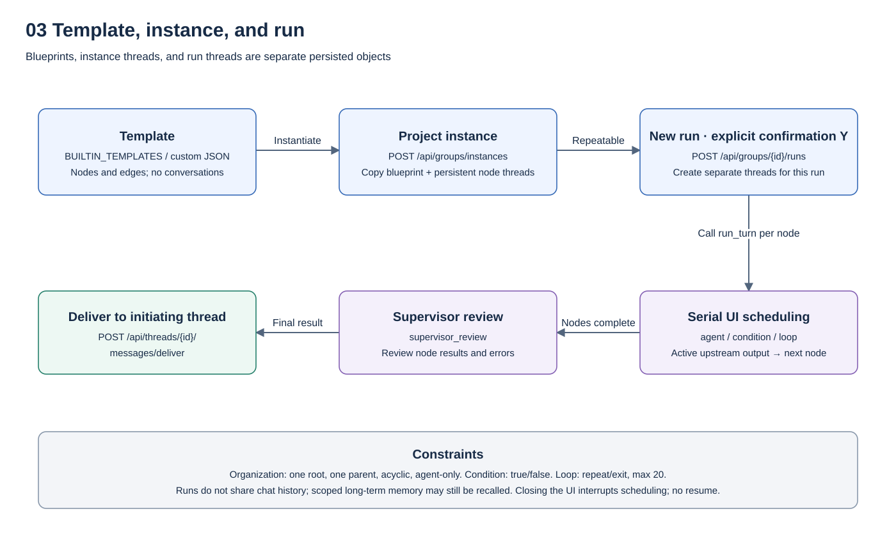
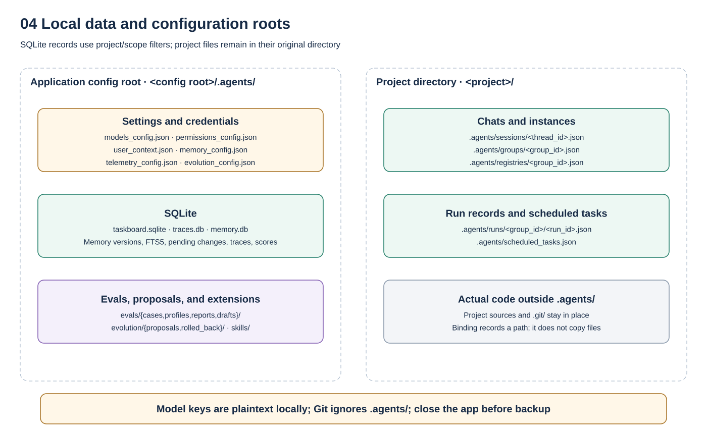
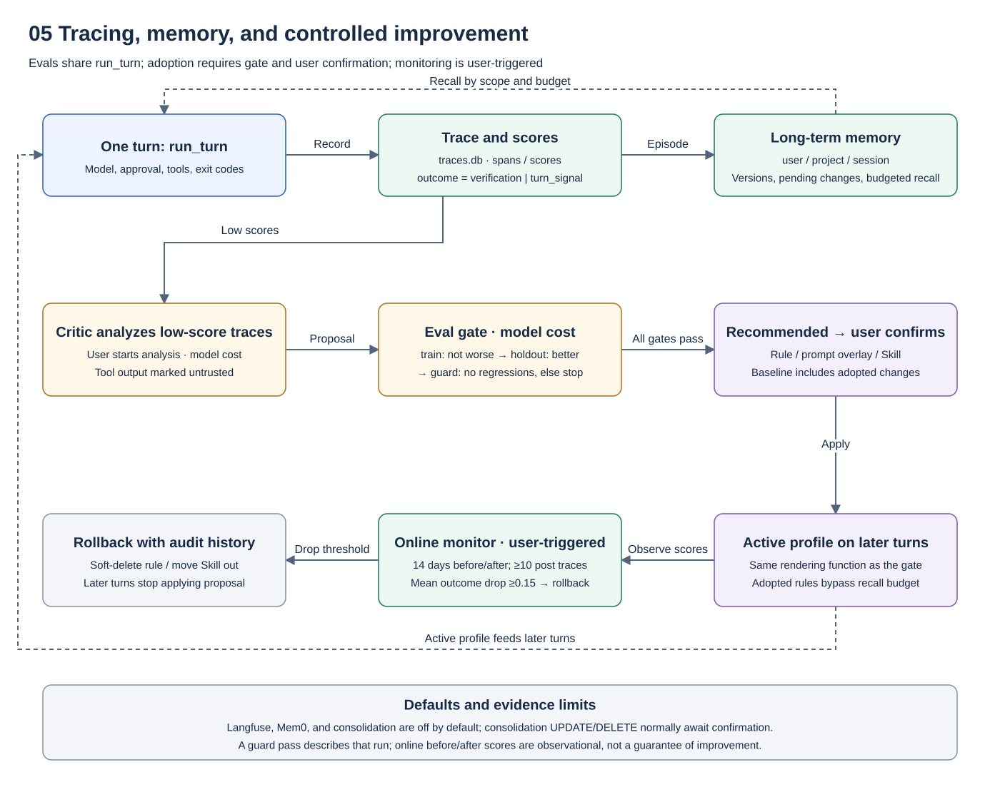

# System design

This page describes the **current implementation** of VeraAgent: its purpose, architecture, design choices, runtime flow, and limitations. The repository source and tests are authoritative. For installation and operation, see the [user documentation](../docs/index.md).

## Overview and goals

VeraAgent is a local AI agent workspace for software projects with an existing code repository. It brings project binding, model conversations, a task board, organization charts, and workflow orchestration into a Windows desktop app. Project files stay in their original directory; model requests still send prompts and selected project context to the configured provider.

The intended deployment is single-user and local. A direct agent conversation and multi-role collaboration use the same conversation engine. Editable templates make reporting lines and workflow steps explicit.

Current non-goals are hosted multi-tenancy, an operating-system sandbox, auditing a model's hidden reasoning, parallel workflow scheduling, and resuming an interrupted workflow run. The local API has no caller authentication and must remain bound to loopback.

## Architecture



```text
React + TypeScript UI (Vite)
          │ HTTP / SSE / WebSocket over loopback
          ▼
Python Starlette API (Uvicorn, starting at 127.0.0.1:8000)
          ├─ ServerState: projects, threads, registries, permissions
          ├─ Agent/model loop: history, model requests, tools, observations
          └─ Local tools: files, terminal, Git, MCP, Skill adapters
          │
          ▼
Local data: application/project .agents (JSON and SQLite), project files, Git state
```

`start-desktop.ps1` builds the UI, starts the local API on an available port starting at 8000, checks `GET /api/topology`, and opens a pywebview/WebView2 window. During development, Vite proxies `/api` to the local backend.

| Layer | Main code | Responsibility |
| --- | --- | --- |
| UI | `frontend/src/` | Projects, conversations, task board, editors, and run status |
| Local API | `vera-agent/src/vera_agent/server/` | Routes, validation, state, permissions, persistence |
| Agent and model | `agents/`, `models/`, `server/chat/` | Model calls, tool actions, approvals, subagents, MCP connections |
| Tools | `tools/`, `environments/` | Files, terminal, Git, MCP, and Skills |
| Data | Application/project `.agents/` and project files | Settings, sessions, runs, tasks, and code |

## Design decisions

**The UI schedules workflow runs.** `workflowRunner.ts` calls `/api/chat/stream` node by node and selects outgoing edges. The backend `PATCH /api/groups/{group_id}/runs/{run_id}` validates and persists state transitions. This makes progress easy to show in the UI, but a refresh or closed window interrupts scheduling; persisted node states do not provide a resume mechanism.

**An organization is a tree.** Architecture mode allows one root, one parent per node, no cycles, and only `agent` nodes. Workflow mode permits a graph and expresses cycles through `loop` nodes. The same tree validation applies when creating instances, updating instances, and saving custom organization templates.

**Stored node types are broader than executable node types.** The `compose_group` protocol accepts many node kinds. The regular editor and runtime currently support `agent`, `condition`, and `loop`. Other kinds can be stored as data but have no runtime executor; their presence in a schema does not make them runnable.

**Template, instance, and run are distinct objects.** A template is a declarative blueprint. Instantiation copies its nodes and edges into a project and creates persistent node threads. Each run creates separate threads, so repeated runs do not share chat history; scoped long-term memory can still be recalled.

## Chat and tool flow



The UI starts a turn with `POST /api/chat/stream` over SSE. The server loads the selected thread, project, and model; calls the model; checks permissions for requested tools; executes approved tools; and feeds observations back into the model until the turn finishes or a limit is reached.

```text
thinking → text_chunk* → [tool_call → approval_required? → tool_result]*
         → context_management? → finish
```

`thinking` is a step-status hint, not hidden model reasoning. When approval is required, the UI sends a separate `POST /api/chat/confirm` with `thread_id`, `action_id`, and `choice`; the default timeout is 300 seconds and rejects on expiry. `/api/chat/interrupt`, `/pause`, and `/resume` control a **single streaming chat turn**, not workflow-run recovery.

## Organization and workflow



1. **Template:** Built-in or saved JSON describing roles, steps, and connections without conversations.
2. **Instance:** `POST /api/groups/instances` copies a template into a project and creates a persistent thread for each agent node.
3. **Run:** After explicit `confirmation: "Y"`, `POST /api/groups/{group_id}/runs` creates isolated run threads. The UI scheduler passes active upstream outputs downstream in topological order. `condition` and `loop` use restricted orchestration controls and strict `YES`/`NO` output. A loop is capped at 1–20 iterations. A final `supervisor_review` result is delivered to the initiating thread with `POST /api/threads/{thread_id}/messages/deliver`.

The organization rules require one root, at most one direct parent per node, no cycles, and `agent` nodes only. A `condition` needs `true` and `false` exits; a `loop` needs `repeat` and `exit` exits. Missing required edges cause a runtime error.

| Scope | Runnable node types | Meaning |
| --- | --- | --- |
| Protocol | Broader set accepted by `compose_group` | Storage and extension surface |
| Editor | `agent`, `condition`, `loop` | Types users can add in the regular editor |
| Runtime | `agent`, `condition`, `loop` | Types with implemented execution logic |

## Local data model



Both the application root and each project may have a Git-ignored `.agents/` directory:

```text
<application root>/.agents/
  projects_history.json, models_config.json, permissions_config.json
  mcp_servers.json, skills/, templates/topology/, taskboard.sqlite
  user_context.json, user_memories.json (one-time legacy import)
  traces.db, memory.db, telemetry_config.json, memory_config.json
  evolution_config.json, evals/{cases,profiles,reports,drafts}/
  evolution/{proposals,rolled_back}/

<project>/.agents/
  sessions/<thread_id>.json
  groups/<group_id>.json
  runs/<group_id>/<run_id>.json
  registries/<group_id>.json
  scheduled_tasks.json
```

Binding a project records its path; it does not copy or isolate project files. Model API keys are stored **in plaintext** in `models_config.json`. API responses omit them, but the file itself is not encrypted.

### Traces, long-term memory, and improvement proposals



Each desktop turn records a trace, model/tool spans, and separate scores. `verification` uses the last recognized test/build/check command's exit code; ordinary commands and version/help queries do not overwrite it. `outcome` prefers verification and otherwise uses `turn_signal`. User feedback and next-message heuristics remain separate.

`memory.db` filters records by user/project/session scope and retains versions, soft deletions, and pending changes. FTS5 trigram plus short-term matching supports Chinese queries. Models cannot write `rule` records. Adopted rules use the same active-profile renderer as the evaluation gate and bypass ordinary recall budgets.

Users start Critic analysis and the train → holdout → guard gate. Fresh Git repositories and independent configuration roots run the same `run_turn`; the baseline includes already adopted changes. Train must not regress, holdout must improve significantly, and guard must have no regressions. A recommendation still requires user confirmation to adopt. The user-triggered monitor compares 14 days before/after adoption and rolls back a mean drop of at least 0.15 after at least 10 post-adoption traces; there is no background timer.

Critic and evals call the configured model and incur costs. Langfuse, Mem0, and memory consolidation are off by default. Local storage does not make provider requests local: prompts and selected context still reach the configured provider. See [Learning loop](../../../../docs/LEARNING_LOOP.md).

## Quality and boundaries

Workflow nodes run serially, even on separate graph branches. This gives deterministic ordering and simpler state validation at the cost of throughput. Task-board writes instead use optimistic locking with a `version` field; stale writes receive HTTP 409.

The unauthenticated local API and permissive CORS must remain on loopback. Model providers receive prompts and selected project context. File, terminal, Git, MCP, and Skill tools run with the current Windows user's permissions; project-path restrictions are application-level checks, not an OS sandbox. Marketplace entries are not security certifications.

Chats, instances, and run records persist as JSON or SQLite, but the UI scheduler does not resume after a restart.

## Known limitations

- No parallel workflow scheduling or recovery after an interrupted workflow run.
- Only `agent`, `condition`, and `loop` are executable in the workflow editor/runtime.
- The unauthenticated API must not be exposed beyond loopback.
- Model credentials are plaintext in local files.
- Terminal, file, and Git operations have no separate OS-level sandbox.

See the repository's [architecture](../../../../docs/ARCHITECTURE.md), [data model](../../../../docs/DATA_MODEL.md), and [API index](../../../../docs/API.md) for further implementation detail.

All diagrams have [SVG exports](../../../diagrams/README.md) and an [editable draw.io source](../../../diagrams/system-design.drawio).
